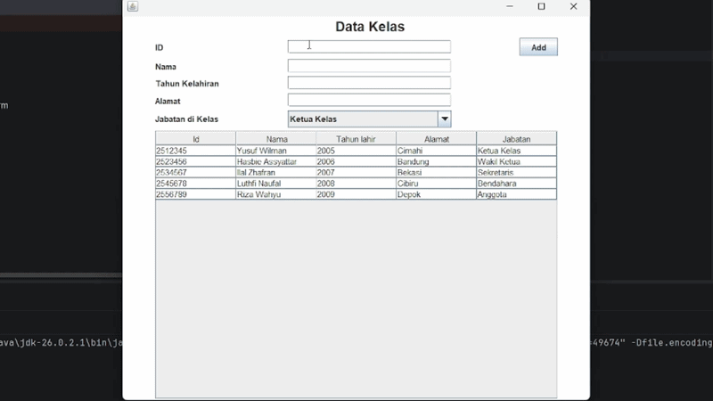
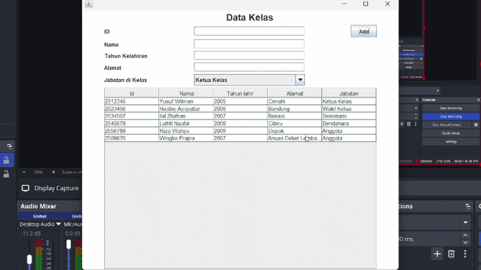

# TP4 DPBO

# Jandji
Saya <strong>Muhamad Hasbie Assyattar</strong> dengan <strong>NIM 2508288</strong> mengerjakan Tugas Praktikum 4 dalam mata kuliah Desain dan Pemrograman Berorientasi Objek untuk keberkahanNya maka saya tidak melakukan kecurangan seperti yang telah dispesifikasikan. Aamiin.

# Desain
- Person
  - id : String
  - nama : String
  - tahunLahir : String
  - alamat : String
  - jabatan : String
- PeopleMenu
  - JTextField textFieldId;
  - JTextField textFieldNama;
  - JTextField textFieldTahun;
  - JTextField textFieldAlamat;
  - JButton buttonAdd;
  - JButton buttonRemove;
  - JComboBox comboBoxJabatan;
  - JLabel labelId;
  - JLabel labelNama;
  - JLabel labelTahun;
  - JLabel labelAlamat;
  - JLabel labelJabatan;
  - JTable table1;
  - JLabel labelJudul;
  - JPanel mainPanel;

# Struktur File
```
Main
├── PeopleData/
│   └── src/
│       ├── Person.java
│       ├── PeopleMenu.java
│       └── PeopleMenu.form
│
├── Dokumentasi/
│   └── Remove.gif
│   └── Add.gif
│
└── README.md
```
# Anuan Program
nanti ada isian Id nama tahun alamat sama combo box isinya jabatan, terus bisa di add sama hapus... kalau mau hapus spilih dulu dari tabelnya

# Dokumentasi

## Add


## Remove
